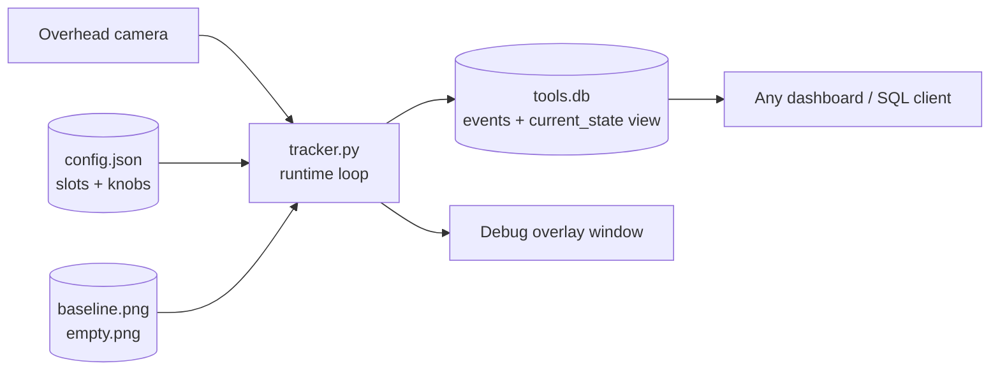
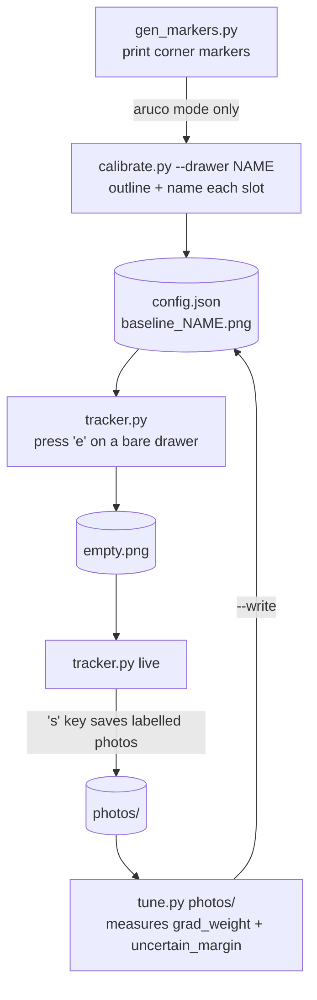
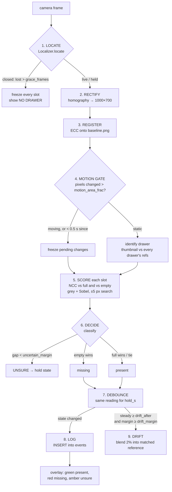
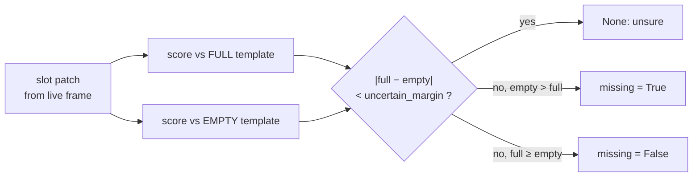
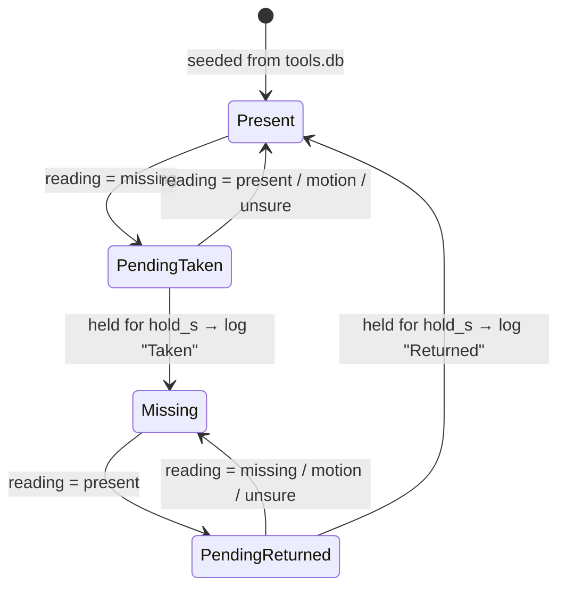
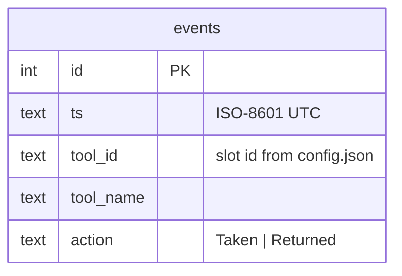

# Architecture

How the Shadow-Foam Tool Tracker works, with schematics. The README has the
measured detail behind each stage; `DECISIONS.md` has what was tried and rejected.

## 1. The system at a glance

An overhead camera watches a foam tool drawer. Every frame is flattened into a
fixed top-down view, each tool slot is compared against two reference photos
(drawer **full** and drawer **empty**), and a confirmed change is written to
SQLite as a `Taken` / `Returned` event. Classic computer vision only — no model,
no training.

## 2. Lifecycle: setup → run → tune

1. **Markers** (`gen_markers.py`) — only for `"localizer": "aruco"`. Four printed
   markers pinned to the drawer corners give the warp, and which way is up.
2. **Calibrate** (`calibrate.py`) — shows the rectified drawer; you drag a rect or
   click a polygon around each tool and name it. Saving writes that drawer's slots
   into `config.json` and the current frame as its `baseline`.
3. **Empty reference** — in the tracker, empty the drawer and press `e`. Without
   it nothing can be classified; every slot reads `UNSURE`.
4. **Run** (`tracker.py`) — the loop below.
5. **Tune** (`tune.py`) — reads labelled photos (`full_*.jpg`, `missing_<id>_*.jpg`)
   and reports, per slot, how far apart "present" and "absent" scores sit. Picks
   the two global knobs from data instead of guesswork.

## 3. Per-frame pipeline (`tracker.main`)

| Stage | Function | Why it exists |
|---|---|---|
| Locate | `Localizer.locate`, `aruco_corners` / `lsd_corners` | Find the drawer every frame; a shut drawer yields *no answer*, never "all tools taken". |
| Rectify | `Localizer.rectify` | Everything downstream assumes one fixed coordinate frame. |
| Register | `register` | A marker knocked 1 mm shifts the whole warp; ECC re-anchors on the drawer itself. Rejects a lock under `REGISTER_MIN_CC`. |
| Motion gate | inline in `main` | A hand over a slot looks exactly like a missing tool. |
| Identify | `identify`, `drawer_score` | One camera, several drawers sharing one marker sheet — tell them apart by looks. |
| Score | `slot_score`, `build_templates`, `slot_mask` | Normalised correlation ignores brightness changes; polygon masks stop the neighbour slot bleeding in. |
| Decide | `classify` | Nearest of two references, no per-slot threshold. Too close → "don't know". |
| Debounce | `Debouncer` | A change must hold steady for `hold_s` on static frames before it counts. |
| Log | `log_event`, `seed_debouncers` | Append-only audit trail; on restart each tool resumes from its last logged state. |
| Drift | `drift` | Long-settled, unambiguous slots slowly track lighting changes. In memory only. |

## 4. Slot decision in detail

Each score is `(1 − grad_weight) · NCC(grey) + grad_weight · NCC(Sobel)`, taken at
the best offset within `±search_radius` pixels.

## 5. Debouncer state machine

Motion and `UNSURE` both call `freeze()`: the pending change is dropped and the
drift counter resets, so a hovering hand never accumulates time.

## 6. Data

`current_state` is a view: the latest event per `tool_id`. A dashboard reads it
while the tracker writes (WAL mode).

`config.json` holds the localizer choice, `warp_size` (never change it after
references exist), scoring knobs, and a `drawers` list — each with its reference
files and slot `rois` (`id`, `name`, `rect`, optional `polygon`).

## 7. Files

| File | Role |
|---|---|
| `tracker.py` | Runtime loop + the shared library everything imports. `--selftest` runs the logic checks without a camera. |
| `calibrate.py` | Interactive slot outlining; writes `config.json` and the baseline. |
| `tune.py` | Measures `grad_weight` / `uncertain_margin` from labelled photos. |
| `gen_markers.py` | Generates `markers.png`. |
| `diagnose.py` | Camera probe. |
| `baseline.png`, `empty.png` | The two references. Must be shot back to back without moving drawer or camera. |
| `photos/`, `training/`, `diagnostics/` | Labelled photo set, intake folder for new photos, and measured evidence behind the design. |

## 8. Live keys

`q` quit · `b` re-baseline (full) · `e` empty reference · `d` show scores ·
`g` toggle grad weight · `s` save labelled photo · `[` `]` uncertain margin ·
`-` `=` motion limit · `w` write knobs to `config.json`
